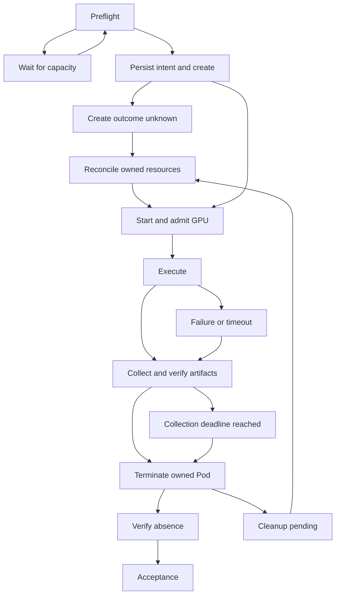

# RunPod CI Broker

A small Python CLI for **bounded, explainable RunPod GPU experiments driven by
GitHub Actions**. It separates experiment requirements from cloud placement,
budgets, recovery and cleanup. MIT licensed; Python 3.12+; managed with uv.

**Current release: no-cost MVP.** Offline planning, a persistent fault-injection
simulator, and a REST v2 **GET-only** preflight adapter are implemented.
Real Pod creation, worker transport, and real cleanup are deliberately disabled.
`--action run` refuses even a populated authorization record. Passing mock tests
is not evidence of a GPU run. See [delivery status](docs/validation.md) and the [phase-2 execution plan](docs/phase-2-plan.md).

## What it solves

- Filter hard constraints before ranking GPU preference and price; explain every rejection.
- Keep numerical reproduction and hardware benchmark groups from silently changing GPUs.
- Require an explicit task budget, GPU allowlist, runtime and non-compute reserves.
- Persist create intent before allocation; reconcile an ambiguous response before doing anything else.
- Separate process success, experiment acceptance, verified artifacts and confirmed Pod deletion.
- Bound waiting, retries and collection. Preserve diagnostics when recovery fails.

This is RunPod Pods + GitHub Actions only. No multi-cloud layer, local GPU routing,
self-hosted runner scheduling, Kubernetes, web console, SaaS, automatic top-ups,
unlimited retries or autoscaling. It never modifies account billing or creates,
deletes or resizes Network/Global Volumes. It contains no project-specific ML logic.

## Quick start — no credentials, no cloud operations

```bash
uv sync --locked --group dev --python 3.12
uv run runpod-ci-broker --config examples/simplexlora-flexible.json \
  --mock-catalog examples/mock-catalog.json --output out/plan
uv run runpod-ci-broker --config examples/simplexlora-flexible.json \
  --action simulate --mock-catalog examples/mock-catalog.json \
  --state-dir .broker/demo --output out/simulation
```

The first command defaults to dry-run. Reports are `report.json` and `summary.md`.
The second simulates the lifecycle; **it does not execute the configured program**.
Example metrics and prices are fictional fixtures, not benchmark findings or quotes.
Without `--mock-catalog`, dry-run is strictly offline and marks availability unknown.

```bash
uv run pytest
uv run ruff check src tests
uv run ruff format --check src tests
uv run mypy src
```

## Three experiment policies

| Policy | Selection behavior | Scenario and executable planning example |
|---|---|---|
| `flexible_smoke` | Fallback only inside the explicit allowlist and compatibility requirements | [SimplexLoRA CUDA/int8 smoke](examples/simplexlora-flexible.json) |
| `strict_repro` | Exactly one GPU, data center, CUDA version, driver and architecture; no relaxation | [Spleeter five-stem FFT comparison](examples/spleeter-strict.json) |
| `hardware_benchmark` | One GPU per task and an explicit group ID; use distinct experiment IDs for other cards | [FlashAttention RTX 3090 pilot](examples/flashattention-hardware.json) |

All three JSON files validate and run in the simulator. Their source SHAs are
inspection snapshots of the real repositories. **Zero image digests, wrapper module
names, driver versions and data centers are illustrative placeholders**. The wrappers
are not implemented or integrated in those repositories. Replace them in a separately
reviewed integration PR; this MVP cannot rent hardware with these examples.
Do not reuse the historical projects' budgets or image provenance as authorization.

Task inputs include full source SHA, image digest, safe literal argv, input hashes,
GPU count/VRAM/allowlist, data centers, an optional existing volume, compatibility,
limits, artifact allowlist and metric gates. Unknown fields and shell/inline-code
arguments are rejected. The CLI does not execute argv. A future live worker must use
an exec-form argument list, a trusted packaged entrypoint, and runtime GPU admission.

Ranking is deterministic: **hard constraints → configured model order → price →
data-center ID**. Missing facts fail closed. A known catalog GPU is not a capacity
reservation. `no_capacity`, `inventory_unknown`, query failures, price, region,
volume, CUDA/driver, authentication, account and permission errors remain distinct.
Hardware groups never borrow another model's result. Strict environment details
that the catalog cannot establish remain blocked pending a reviewed admission design.

## Lifecycle and recovery



`PREFLIGHT_BLOCKED`, `NO_CAPACITY`, `BUDGET_INSUFFICIENT`, `CREATE_UNKNOWN`,
`RUN_FAILED`, `TIMED_OUT`, `COLLECTION_FAILED` and `CLEANUP_PENDING` are explicit
states, not success labels. A task is `ACCEPTED` only after its success criteria,
verified local export and confirmed cleanup all hold. In this release every
accepted lifecycle is **mock evidence** and `gpu_verified` remains false.

The journal binds experiment ID, config SHA256, original Actions run ID, resume
run IDs, source SHA, fixed image and Pod ID. A reused experiment ID with different
configuration is refused. Names and a small set of non-secret `env` ownership
markers use documented RunPod fields; they are not invented provider metadata.
Ownership is an accidental-deletion guard, not a security boundary against someone
who can alter the RunPod account or trusted journal.

An unresolved create **never becomes retryable merely because inventory is empty**.
A known explicit capacity rejection can retry within the total attempt/wait caps.
Authentication, authorization, account restrictions and ownership ambiguity stop.
Cleanup sends termination only for an exact journal/name/marker/image/mount match,
then requires two complete absent observations. A delete response alone does not
prove removal. No Stop operation exists in Broker.

```bash
# Inject lost create response, one collection error, one delete failure.
uv run runpod-ci-broker --config examples/simplexlora-flexible.json \
  --action simulate --mock-catalog examples/mock-catalog.json \
  --faults examples/faults.json --state-dir .broker/fault-demo --output out/faults
# Exit 2 / CLEANUP_PENDING is expected after the bounded deletion checks.
uv run runpod-ci-broker --config examples/simplexlora-flexible.json \
  --action reconcile --mock-catalog examples/mock-catalog.json \
  --state-dir .broker/fault-demo --output out/recovered
```

Re-run `simulate` with the same state directory to resume execution/collection;
it cannot create another Pod after ambiguous creation. `reconcile` performs
bounded cleanup and acceptance without a new create; `cleanup` additionally marks
the experiment cancelled. These entrypoints are **mock-only** until phase 3.
Keep the journal and fake provider file together for recovery. Never edit an old
journal to reuse an exhausted experiment. See [failure contracts](docs/recovery.md).

## Budget and concurrency boundaries

The estimate reserves **all permitted attempts**, each with startup/image-pull,
execution, collection and cleanup time. It adds per-GPU rate × count, temporary
storage rate, transfer/request/cleanup reserves and known prior spend. Rates and
reserves must be supplied explicitly; zero means a deliberate zero assumption.
No cap, allowlist or runtime means no execution admission. A JSON authorization
flag is a software check, not proof of user approval.

Estimated costs, observed runtime costs and supplier billing are separate fields;
the last two remain null here. Catalog prices are per GPU; Pod `cost` is an hourly
compute rate, **not an invoice**. Existing persistent storage charges can continue
after compute deletion. The current Pod pricing page says no Pod ingress/egress
fee; external destinations and Global Volume requests still need their own review.

No verified provider-level **per-task total-dollar hard cap** is available in the
reviewed contract. Account balance/hourly limits are not that guarantee. Runner
loss, delayed inventory and provider outages can defeat software deadlines.
**Broker does not promise zero overspend.** Paid execution stays disabled until
independent recovery and durable intent storage are implemented and reviewed.

Local `flock` serializes one state directory/scope; unresolved records block another
experiment in that scope. Provider inventory is a second check, not an atomic lock.
GitHub `concurrency` applies to the **caller repository and group**, not the RunPod
account. Different repositories/runners do not share a global lock. For phase 3,
route launches through one central broker repository and add a durable ledger;
do not enable separate callers that race to allocate.

## Results, security and Actions

The simulator verifies the exact artifact allowlist, sizes, SHA256 hashes,
source/config/image/Pod provenance and metric gates. It writes files outside the
fake Pod, then writes the manifest last. The report records metrics, exit status,
events, attempts, candidate decisions, costs and cleanup evidence. Collection
failure retries until its limit/deadline, then terminates compute while retaining
diagnostics. It never holds a billable GPU indefinitely to save results.

A real worker export transport and off-runner durable journal are **phase-3 gates**.
The planned transport is a per-task authenticated HTTPS result endpoint with bounded
streaming and verified hashes, plus an independently accessible durable checkpoint
location when required. The worker receives only an ephemeral result capability;
never the account API key. GitHub artifacts are an export destination after the
runner has verified the bundle, not a transactionally durable create-intent store.
See [recovery and export contract](docs/recovery.md).

- PR CI runs offline tests only, with `contents: read`; no cloud secrets or paid triggers.
- Actions and Broker source references are pinned; dependencies use `uv.lock`.
- [Reusable planning workflow](.github/workflows/broker-plan.yml) accepts JSON data
  and a full Broker commit SHA. It receives **no secrets** and executes dry-run only.
- [Read-only preflight](.github/workflows/read-only-preflight.yml) is manual, main-only,
  with `RUNPOD_API_KEY` scoped to its GET-only command. It does not pass the key into
  a Pod, print raw environments or serialize provider error bodies. Use a read-only
  key with the required resource permissions when available.
- No `pull_request_target`, image publication, paid workflow or implicit credential inheritance.
- `finally` and `always()` do not survive every cancellation/runner-loss case. This
  release makes no live cleanup promise and adds no scheduled account-wide reaper.

For read-only preflight on an already trusted environment with the secret configured:

```bash
uv run runpod-ci-broker --config examples/simplexlora-flexible.json \
  --action preflight --output out/preflight
```

A missing key produces an unknown-inventory report and exit 2; it does not block
local development. No key should be pasted into a task file, command argument or chat.
Do not grant credentials to fork/untrusted PR workflows.

### CUDA filtering and stock diagnostics

The flexible smoke template uses `compatibility.min_cuda_version: "12.8"` and a
**USD 3 per GPU-hour** ceiling. RTX 5090 is already in its allowlist. The task's
total budget remains illustrative, with no paid authorization. `cuda_versions`
means exact host catalog versions; it is mutually exclusive with the numeric floor.
Strict reproduction remains exact. A host catalog match does not prove image CUDA,
PTX/kernel or device-architecture compatibility.

For the manual preflight, enable `diagnose_cuda=true` (CLI: `--diagnose-cuda`) to
compare exact, minimum and unfiltered inventory without changing admission.
[Parameters, query bounds and interpretation](docs/cuda-preflight.md).

Reusable caller shape (replace both placeholders with the same reviewed full SHA):

```yaml
jobs:
  plan:
    uses: jasonjiang8866/runpod-ci-broker/.github/workflows/broker-plan.yml@FULL_BROKER_COMMIT_SHA
    with:
      broker_sha: FULL_BROKER_COMMIT_SHA
      task_json: '{"...": "the full validated task JSON"}'
```

## Roadmap and evidence

1. **Merged MVP:** no-cost CLI, schema, planner, state machine/fakes, local tests,
   workflows, three scenario templates and [current repository audit](docs/repository-audit.md).
2. **Read-only:** use the reviewed manual workflow after merge and credential setup;
   verify returned model IDs, prices, inventory and configured volume compatibility.
   See [the exact inputs and acceptance checks](docs/phase-2-plan.md). Not yet run.
3. **Separately authorized GPU smoke:** complete the live adapter, worker admission,
   durable intent store and independently invokable recovery before proposing a
   concrete GPU, reviewed image, maximum duration and total cost. No standing authorization.
4. **Separate integration PR:** simplest smoke first; no business repository changes
   are included. Strict numerical checks and hardware groups follow later.

[Official API capability matrix](docs/api-capabilities.md) distinguishes documented
fields from estimates, unavailable runtime facts and unverified live account capability.
