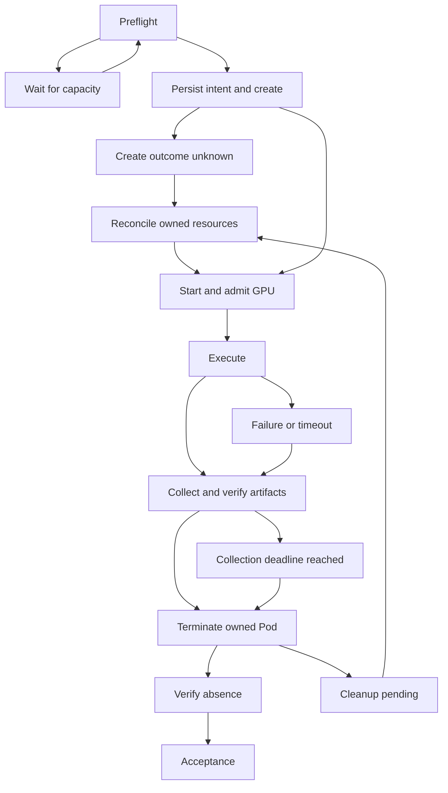

# RunPod CI Broker

A Python CLI for **finding and renting GPUs on RunPod and DigitalOcean through GitHub Actions**. It separates experiment requirements from cloud placement,
budgets, recovery and cleanup. MIT licensed; Python 3.12+; managed with uv.

**A core goal is to help users find rentable GPUs:** search across eligible models
and data centers, explain tradeoffs, and learn from explicit capacity refusals.
The first adaptive finder is GET-only, with bounded polling and a ranked candidate
queue. Capacity feedback is integrated into the simulator and an opt-in path in
the fixed live controller. A task-bound single-task controller now has offline
coverage for capacity fallback under one budget and execution window, reconciliation,
smoke export and verified cleanup. Manual launch and independent recovery workflows
are implemented; the committed release manifest controls paid activation.
[Resource discovery](docs/resource-discovery.md) and the
[three-stage allocation/solver plan / 实施计划](docs/resource-allocation-plan.md)
describe the implementation and acceptance gates.

**Current status: real GPU smoke accepted.** On 2026-11-17 Singapore time,
[run 43931230068](https://github.com/jasonjiang8866/runpod-ci-broker/actions/runs/43931230068)
verified a Blackwell MIG 24GB CUDA memory roundtrip, downloaded checksum-verified
results, verified their GitHub upload receipt and confirmed Pod deletion. The
[recovery re-entry](https://github.com/jasonjiang8866/runpod-ci-broker/actions/runs/43931669505)
also passed. [Acceptance evidence and limits](docs/evidence/smoke-43931230068.md)
record the outcome and cost accounting; original files remain in Actions artifacts.

A second [paid regression](https://github.com/jasonjiang8866/runpod-ci-broker/actions/runs/43938726780)
also passed on 2026-11-17, including cleanup and recovery. See the
[regression and investigation reflection](docs/gpu-regression-postmortem.md).

The blocker was confirmed capacity refusal despite an available catalog signal,
with fixed ranking repeatedly preferring the failed placement. The repair retains
error reasons, waits for authenticated worker readiness and permits one bounded
alternate placement after that known refusal. The API key was unchanged.
The historical 403's exact origin remains unproven. See the
[repair record](docs/live-repair.md).

This is a fixed CUDA driver memory smoke, not model training or a framework
benchmark. Generic Pod creation remains disabled in the default CLI;
`--action run` refuses even a populated authorization record. Historical campaign
records and reservations are retained, and reruns never create another Pod.

## What it solves

- Search eligible GPU/data-center pairs by stock signal, preference or price;
  retain alternatives, refresh with bounded backoff and explain every rejection.
- Temporarily cool down an explicitly refused placement instead of repeating it
  indefinitely; this feedback loop is currently opt-in in the simulator.
- Keep numerical reproduction and hardware benchmark groups from silently changing GPUs.
- Require an explicit task budget, GPU allowlist, runtime and non-compute reserves.
- Persist create intent before allocation; reconcile an ambiguous response before doing anything else.
- Separate process success, experiment acceptance, verified artifacts and confirmed Pod deletion.
- Bound waiting, retries and collection. Preserve diagnostics when recovery fails.

Workload execution uses RunPod Pods. The DigitalOcean pilot provisions and deletes a GPU Droplet. No local GPU routing,
self-hosted runner scheduling, Kubernetes, web console, SaaS, automatic top-ups,
unlimited retries or autoscaling. It never modifies account billing or creates,
deletes or resizes Network/Global Volumes. It contains no project-specific ML logic.

## Quick start — no credentials, no cloud operations

```bash
uv sync --locked --group dev --python 3.12
uv run runpod-ci-broker --config examples/simplexlora-flexible.json \
  --mock-catalog examples/mock-catalog.json --output out/plan
uv run runpod-ci-broker --config examples/simplexlora-flexible.json \
  --action simulate --mock-catalog examples/mock-catalog.json \
  --state-dir .broker/demo --output out/simulation
```

The first command defaults to dry-run. Reports are `report.json` and `summary.md`.
The second simulates the lifecycle; **it does not execute the configured program**.
Example metrics and prices are fictional fixtures, not benchmark findings or quotes.
Without `--mock-catalog`, dry-run is strictly offline and marks availability unknown.

## Global GPU offers and DigitalOcean rentals

Compare exact GPU variants across all advertised regions. The default profile
requests one GPU with an inclusive **USD 5 per GPU-hour** ceiling. The report
shows both the unit and full-instance hourly prices, the provider's capacity
signal, exclusions and any incomplete provider reads.

```bash
uv run runpod-ci-broker --action offers --config examples/global-gpu-market.json
uv run runpod-ci-broker --action offers --config examples/global-gpu-market.json --provider digitalocean
```

The manual **Global GPU offers** workflow uses the repository's existing
`DIGITALOCEAN_ACCESS_TOKEN` and `RUNPOD_API_KEY`. It saves `out/offers.json`.
RunPod Secure Cloud reports placement stock. DigitalOcean on-demand reports
regions where a size is offered. Both can refuse a subsequent allocation.
Spot capacity is available separately below.

**DigitalOcean GPU rental** is a manual, main-only provisioning pilot. It
refreshes global H100/H200 single-GPU offers before each attempt. On a
definitive capacity refusal it tries another eligible placement, preferring
a different region, up to three attempts. Ambiguous creates go to recovery.
The pilot waits for Droplet status `active`, then deletes and verifies
absence by ID and complete name-matched inventory twice. The companion recovery
workflow can repeat cleanup after the launch runner exits.

The pilot uses the existing `DIGITALOCEAN_ACCESS_TOKEN` for size and Droplet
reads, creation and deletion. Set the repository Actions variable
`DO_SSH_KEY_ID` to the numeric ID or colon-delimited MD5 fingerprint of a public
SSH key already registered with the same DigitalOcean team. The read-only
preflight checks the identifier format and Droplet inventory access. DigitalOcean
validates the key during creation. In the [live GPU pilot](https://github.com/jasonjiang8866/runpod-ci-broker/actions/runs/45056541947),
DigitalOcean rejected a public key supplied only through cloud-init before
allocating a Droplet. New rentals use a random instance name and store a
per-rental credential binding in the encrypted journal. Recovery requires the
original DO token until deletion is confirmed. A rotated token blocks automatic
settlement, even when it belongs to the same team. Older tagged records retain
their original team and tag checks.
Keep the existing campaign's journal encryption key available. Select
`confirm_paid` only when ready to spend. The single-use reservation carries
forward USD 16.003502 and adds USD 1.75 and 900 seconds within the existing
USD 20 / 18,000-second campaign. Provider charges can continue until deletion
succeeds. Recovery preserves unresolved intent. An operator can rerun
**Recover DigitalOcean GPU rental** with the rental's original credential.
CUDA worker execution and artifact receipt on Droplets await a separate
integration. [DigitalOcean custom API scopes](https://docs.digitalocean.com/reference/api/scopes/).

## DigitalOcean Spot GPU inventory

Run `uv run python -m runpod_ci_broker.do_spot` for a credential-free JSON
snapshot of the [official hourly Spot capacity table](https://docs.digitalocean.com/products/droplets/details/spot-gpu-capacity/).
Each model and datacenter has one of three states: `available`, `no_capacity`,
or `not_offered`. The timestamp records retrieval. Account eligibility and
allocatable quantity remain unknown. A failed fetch or an unrecognized table
exits nonzero. This command can run independently of the RunPod controller.

For on-demand plans, the [regional catalog](https://docs.digitalocean.com/products/droplets/details/gpu-availability/)
lists supported locations. The [Sizes API](https://docs.digitalocean.com/reference/api/reference/sizes/)
accepts `gpu_minimum=1` for an authenticated catalog query. Plan availability
does not reserve a GPU. The on-demand rental pilot uses the authenticated catalog.

## Adaptive resource discovery

```bash
# Rank fictional candidates without credentials or network access.
uv run runpod-ci-broker --config examples/simplexlora-flexible.json \
  --action discover --mock-catalog examples/mock-catalog.json --output out/search
# Simulate a catalog/create capacity race and select another eligible placement.
uv run runpod-ci-broker --config examples/simplexlora-flexible.json \
  --action simulate --mock-catalog examples/mock-catalog.json \
  --search-policy examples/resource-search-policy.json \
  --faults examples/resource-search-capacity-race.json \
  --state-dir .broker/search-demo --output out/search-demo
```

For real GET-only discovery, omit `--mock-catalog` and provide `RUNPOD_API_KEY`
through the existing secret mechanism, or select `mode: discover` in the manual
read-only workflow. Review task constraints and query limits first. Example task
images, costs and programs remain fixtures; finding a candidate is not deployment
validation or permission to rent it. Reports include the candidate queue, ranking
reasons, exclusions, query timeline and quote expiry. Stock grades are **ordinal
signals, not allocation probabilities or reservations**.

Discovery preserves the GPU allowlist, CUDA/VRAM, cloud, region, volume, budget and
benchmark restrictions. The generic `run` action remains disabled. See
[policy, failure handling and next milestones](docs/resource-discovery.md).

The planner has a pure `PlacementSolver` interface and a `ranked-first-v1`
baseline. Its proposals reference only admitted candidate IDs; the caller
independently checks snapshot identity, assignment count and total reservation.
The interface can represent multiple jobs, but current entrypoints submit one job
and the baseline rejects batch problems. No MILP/constraint solver is installed.
The [implementation plan](docs/resource-allocation-plan.md) separates real
allocation feedback, shared task queues and solver evaluation.

The prepared `BoundedController` API uses this same planner, persists an independent
intent for each allowed attempt, and reserves the full attempt budget before its
first POST. Only an explicit, classified capacity rejection allows another attempt.
It supports the single-GPU CUDA memory smoke worker, including PRO 6000 Server,
Workstation, Max-Q and MIG 24/48GB alongside 3090/4090/5090. The reviewed manual
workflow uses a digest-pinned release manifest; arbitrary training is not enabled.
See [single-task allocation and recovery](docs/bounded-allocation.md) for its API,
failure contract, offline evidence and remaining activation gates.

The latest [paid allocation regression](docs/bounded-allocation.md#november-18-paid-regression)
passed on an RTX 4090. Global search needed one create attempt. The broker verified
CUDA memory access, the result upload receipt and Pod deletion. Independent
recovery also passed. The completed run's launch manifest is disabled.

```bash
uv run pytest
uv run ruff check src tests
uv run ruff format --check src tests
uv run mypy src
```

## Three experiment policies

| Policy | Selection behavior | Scenario and executable planning example |
|---|---|---|
| `flexible_smoke` | Fallback only inside the explicit allowlist and compatibility requirements | [SimplexLoRA CUDA/int8 smoke](examples/simplexlora-flexible.json) |
| `strict_repro` | Exactly one GPU, data center, CUDA version, driver and architecture; no relaxation | [Spleeter five-stem FFT comparison](examples/spleeter-strict.json) |
| `hardware_benchmark` | One GPU per task and an explicit group ID; use distinct experiment IDs for other cards | [FlashAttention RTX 3090 pilot](examples/flashattention-hardware.json) |

All three JSON files validate and run in the simulator. Their source SHAs are
inspection snapshots of the real repositories. **Zero image digests, wrapper module
names, driver versions and data centers are illustrative placeholders**. The wrappers
are not implemented or integrated in those repositories. Replace them in a separately
reviewed integration PR; this MVP cannot rent hardware with these examples.
Do not reuse the historical projects' budgets or image provenance as authorization.

Task inputs include full source SHA, image digest, safe literal argv, input hashes,
GPU count/VRAM/allowlist, data centers, an optional existing volume, compatibility,
limits, artifact allowlist and metric gates. Unknown fields and shell/inline-code
arguments are rejected. The CLI does not execute argv. A future live worker must use
an exec-form argument list, a trusted packaged entrypoint, and runtime GPU admission.

Ranking is deterministic: **hard constraints → configured model order → price →
data-center ID**. Missing facts fail closed. A known catalog GPU is not a capacity
reservation. `no_capacity`, `inventory_unknown`, query failures, price, region,
volume, CUDA/driver, authentication, account and permission errors remain distinct.
Hardware groups never borrow another model's result. Strict environment details
that the catalog cannot establish remain blocked pending a reviewed admission design.

## Lifecycle and recovery



`PREFLIGHT_BLOCKED`, `NO_CAPACITY`, `BUDGET_INSUFFICIENT`, `CREATE_UNKNOWN`,
`RUN_FAILED`, `TIMED_OUT`, `COLLECTION_FAILED` and `CLEANUP_PENDING` are explicit
states, not success labels. A task is `ACCEPTED` only after its success criteria,
verified local export and confirmed cleanup all hold. The fixed live campaigns have two independently verified GPU acceptances; simulator
results remain **mock evidence** and cannot establish GPU verification.

The journal binds experiment ID, config SHA256, original Actions run ID, resume
run IDs, source SHA, fixed image and Pod ID. A reused experiment ID with different
configuration is refused. Names and a small set of non-secret `env` ownership
markers use documented RunPod fields; they are not invented provider metadata.
Ownership is an accidental-deletion guard, not a security boundary against someone
who can alter the RunPod account or trusted journal.

An unresolved create **never becomes retryable merely because inventory is empty**.
A known explicit capacity rejection can retry within the total attempt/wait caps.
Authentication, authorization, account restrictions and ownership ambiguity stop.
Cleanup sends termination only for an exact journal/name/marker/image/mount match,
then requires two complete absent observations. A delete response alone does not
prove removal. No Stop operation exists in Broker.

```bash
# Inject lost create response, one collection error, one delete failure.
uv run runpod-ci-broker --config examples/simplexlora-flexible.json \
  --action simulate --mock-catalog examples/mock-catalog.json \
  --faults examples/faults.json --state-dir .broker/fault-demo --output out/faults
# Exit 2 / CLEANUP_PENDING is expected after the bounded deletion checks.
uv run runpod-ci-broker --config examples/simplexlora-flexible.json \
  --action reconcile --mock-catalog examples/mock-catalog.json \
  --state-dir .broker/fault-demo --output out/recovered
```

Re-run `simulate` with the same state directory to resume execution/collection;
it cannot create another Pod after ambiguous creation. `reconcile` performs
bounded cleanup and acceptance without a new create; `cleanup` additionally marks
the experiment cancelled. These entrypoints are **mock-only** until phase 3.
Keep the journal and fake provider file together for recovery. Never edit an old
journal to reuse an exhausted experiment. See [failure contracts](docs/recovery.md).

## Budget and concurrency boundaries

The estimate reserves **all permitted attempts**, each with startup/image-pull,
execution, collection and cleanup time. It adds per-GPU rate × count, temporary
storage rate, transfer/request/cleanup reserves and known prior spend. Rates and
reserves must be supplied explicitly; zero means a deliberate zero assumption.
No cap, allowlist or runtime means no execution admission. A JSON authorization
flag is a software check, not proof of user approval.

Estimated costs, observed runtime costs and supplier billing are separate fields;
the last two remain null here. Catalog prices are per GPU; Pod `cost` is an hourly
compute rate, **not an invoice**. Existing persistent storage charges can continue
after compute deletion. The current Pod pricing page says no Pod ingress/egress
fee; external destinations and Global Volume requests still need their own review.

No verified provider-level **per-task total-dollar hard cap** is available in the
reviewed contract. Account balance/hourly limits are not that guarantee. Runner
loss, delayed inventory and provider outages can defeat software deadlines.
**Broker does not promise zero overspend.** The narrow paid controller requires
reviewed manual workflow activation, a durable intent record and independent
recovery; see [its exact boundaries](docs/live-controller.md).

Local `flock` serializes one state directory/scope; unresolved records block another
experiment in that scope. Provider inventory is a second check, not an atomic lock.
GitHub `concurrency` applies to the **caller repository and group**, not the RunPod
account. Different repositories/runners do not share a global lock. For phase 3,
route launches through one central broker repository and add a durable ledger;
do not enable separate callers that race to allocate.

## Results, security and Actions

The simulator verifies the exact artifact allowlist, sizes, SHA256 hashes,
source/config/image/Pod provenance and metric gates. It writes files outside the
fake Pod, then writes the manifest last. The report records metrics, exit status,
events, attempts, candidate decisions, costs and cleanup evidence. Collection
failure retries until its limit/deadline, then terminates compute while retaining
diagnostics. It never holds a billable GPU indefinitely to save results.

A shared conditional journal and bounded HTTPS result transport are implemented
and tested offline. The real GitHub journal conflict/release probe now passes;
live RunPod result transport and controller recovery remain **phase-3 gates**.
See [implementation and recovery drills](docs/durable-recovery.md). The result-only
endpoint uses a per-task capability, byte/time limits and verified hashes. An
independently accessible durable checkpoint location is still needed when required. The worker receives only an ephemeral result capability;
never the account API key. GitHub artifacts are an export destination after the
runner has verified the bundle, not a transactionally durable create-intent store.
See [recovery and export contract](docs/recovery.md).

- PR CI runs offline tests only, with `contents: read`; no cloud secrets or paid triggers.
- Actions and Broker source references are pinned; dependencies use `uv.lock`.
- [Reusable planning workflow](.github/workflows/broker-plan.yml) accepts JSON data
  and a full Broker commit SHA. It receives **no secrets** and executes dry-run only.
- [Read-only preflight](.github/workflows/read-only-preflight.yml) is manual, main-only,
  with `RUNPOD_API_KEY` scoped to its GET-only command. It does not pass the key into
  a Pod, print raw environments or serialize provider error bodies. Use a read-only
  key with the required resource permissions when available.
- Image publication is a separately approved, manual main-only workflow with
  `packages: write`. The manual state probe uses repository-wide `contents: write`.
  Neither receives the RunPod key. See [activation evidence](docs/evidence/activation-20261107.md).
- Proposed paid/recovery workflows use `contents: write` and `actions: read`, with
  the account key scoped to controller steps. They await separate activation review.
- No `pull_request_target`, paid push trigger or implicit credential inheritance.
- `finally` and `always()` do not survive every cancellation/runner-loss case. This
  release makes no live cleanup promise and adds no scheduled account-wide reaper.

For read-only preflight on an already trusted environment with the secret configured:

```bash
uv run runpod-ci-broker --config examples/simplexlora-flexible.json \
  --action preflight --output out/preflight
```

A missing key produces an unknown-inventory report and exit 2; it does not block
local development. No key should be pasted into a task file, command argument or chat.
Do not grant credentials to fork/untrusted PR workflows.

### CUDA filtering and stock diagnostics

The flexible smoke template uses `compatibility.min_cuda_version: "12.8"` and a
**USD 3 per GPU-hour** ceiling. RTX 5090 is already in its allowlist. The task's
total budget remains illustrative, with no paid authorization. `cuda_versions`
means exact host catalog versions; it is mutually exclusive with the numeric floor.
Strict reproduction remains exact. A host catalog match does not prove image CUDA,
PTX/kernel or device-architecture compatibility.

For the manual preflight, enable `diagnose_cuda=true` (CLI: `--diagnose-cuda`) to
compare exact, minimum and unfiltered inventory without changing admission.
[Parameters, query bounds and interpretation](docs/cuda-preflight.md).

Reusable caller shape (replace both placeholders with the same reviewed full SHA):

```yaml
jobs:
  plan:
    uses: jasonjiang8866/runpod-ci-broker/.github/workflows/broker-plan.yml@FULL_BROKER_COMMIT_SHA
    with:
      broker_sha: FULL_BROKER_COMMIT_SHA
      task_json: '{"...": "the full validated task JSON"}'
```

## Roadmap and evidence

The fixed campaign retains its **USD 20 / five-hour ceiling** and USD 3/GPU-hour
unit cap. [Real acceptance](docs/evidence/smoke-43931230068.md) used one MIG slice
for 108.78 seconds and confirmed deletion; all preceding reservations remain.

1. **Planning and simulation:** schema, deterministic selection, journal, recovery
   and three scenario templates are available without credentials.
2. **Live fixed smoke:** shared state, immutable publication, runtime CUDA admission,
   readiness, result export, durable receipt and owned cleanup have passed.
3. **Next integration:** package one business workload with its own immutable image,
   result contract and bounded acceptance run. Existing business repositories and
   generic live execution are not enabled by the fixed smoke result.
4. **Later:** injected runner-loss recovery, strict numerical reproduction and
   hardware benchmark groups with their own evidence.

[Official API capability matrix](docs/api-capabilities.md) distinguishes documented
fields from estimates, unavailable runtime facts and unverified live account capability.
