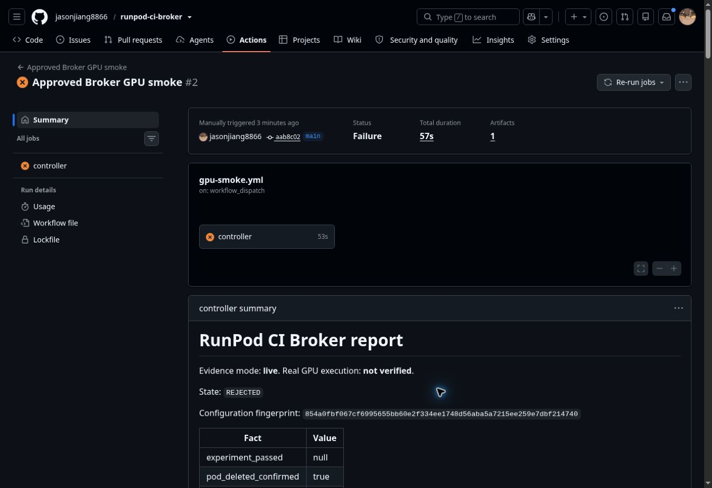

# First live controller attempt — rejected, deletion verified

Observed 2026-11-09 (Asia/Singapore). This is a real RunPod allocation and cleanup
record, **not a successful GPU smoke**. No CUDA observation or workload bundle was
recovered, so framework compatibility and numerical correctness remain unverified.

## Evidence

- [PR #9](https://github.com/jasonjiang8866/runpod-ci-broker/pull/9) merged as
  `aab8c0288611d6fa03e042cfa08cd29d9d080d56` after passing offline/build CI.
- [No-cost trigger](https://github.com/jasonjiang8866/runpod-ci-broker/actions/runs/42596421923)
  used `confirm_paid=false`; the primary job was skipped.
- [Automatic no-cost recovery](https://github.com/jasonjiang8866/runpod-ci-broker/actions/runs/42596430761)
  succeeded. Collect/cleanup/report each logged `NO_OWNED_INTENT`, `runpod_operations: 0`.
- [Paid smoke](https://github.com/jasonjiang8866/runpod-ci-broker/actions/runs/42596594291)
  used `confirm_paid=true`, on the same merge SHA.
- [Completion-triggered recovery](https://github.com/jasonjiang8866/runpod-ci-broker/actions/runs/42596713441)
  preserved the rejected outcome and confirmed-deletion record. Its final report
  exited nonzero because the experiment was unaccepted; it did not create a Pod.
- [Diagnostic artifact](https://github.com/jasonjiang8866/runpod-ci-broker/actions/runs/42596594291/artifacts/13663463191)
  was downloaded and its ZIP SHA-256 verified:
  `fc1f5e58ccc6b842c33293e8ec8c3b46a67c7406cf82d5968a935b89a0c5f7f3`.
  The parsed report is preserved in [JSON](smoke-42596594291.json), including its
  original, now-known misleading planner notice. It is not a worker artifact.

## Outcome and cost

| Fact | Observed result |
|---|---|
| Configuration fingerprint | `854a0fbf067cf6995655bb60e2f334ee1748d56aba5a7215ee259e7dbf214740` |
| Allocation | One NVIDIA GeForce RTX 3090, 24 GB catalog VRAM, EUR-IS-2 |
| Pod ID | `b1mxswhzg2no4k` |
| Create requests | One; no retry or replacement |
| Provider-observed hourly rate | USD 0.50 compute/hour |
| Collection | HTTP 403, `result_permission_denied`, first collection attempt |
| CUDA / experiment pass | Unverified / unknown |
| Worker results saved | False |
| Cleanup | Two direct GET 404s plus two complete inventories without the Pod |
| Task outcome | `REJECTED`, `task_completed=true`, `pod_deleted_confirmed=true` |
| Intent-to-deletion interval | Approximately 30.95 seconds |
| Conservative elapsed estimate | USD 0.525796, including USD 0.50 reserves and using the USD 3/hour ceiling |
| Supplier bill | Unavailable; no final-charge claim |

The whole-attempt reservation remains USD 1.000167; it is not refunded or reset by
rerunning Actions. The existing campaign authorization remains USD 20 total / five
hours, at most USD 3/GPU-hour. No persistent volume was created or deleted.

Worker source remains `2e6fe6930c02fc2469079a1d8e64025562aff07f`; image:
`ghcr.io/jasonjiang8866/runpod-ci-broker-worker@sha256:d1a450f816d71169c29eb53217d869baa88d9eeaa156911f06b83b8a93f9ad11`.
The runner's anonymous digest pull/source-label check passed before POST. This
does not prove that the remote container finished startup or executed CUDA.

## Diagnosis and follow-up

The collector maps HTTP 403 to `result_permission_denied`. The current worker
handler returns 401 for an invalid result capability and has no 403 branch.
That narrows the investigation, but does **not** identify the responding proxy,
network layer, or prove whether the worker started. Raw response headers/body
were intentionally not retained, so the exact cause is unknown. This is not
evidence of insufficient capacity, a CUDA mismatch, or a RunPod account-key failure.

The configured HTTPS proxy address matches the official
[HTTP proxy format](https://github.com/runpod/docs/blob/main/integrations/overview.mdx).
No account key should be sent to this workload endpoint. Do not bypass a denial,
turn off authentication/TLS, retry 403 blindly, or label it transient inventory.

This follow-up adds sanitized HTTP status/stage with an explicitly unverified
response origin to future reports, displays errors in Markdown, and removes the
stale planner claim that no GPU was executed from newly started live records.
It does not repair or claim to repair the remote 403. Nine new offline cases cover
status classification, secret omission, cleanup on 403 and no second create.

Before another paid attempt: establish the proxy response source using bounded,
secret-safe diagnostics and inspect startup evidence; then review any required
transport/readiness fix and an attempt extension preserving this campaign's
history, original deadlines and spend. The one-attempt guard remains in place.

